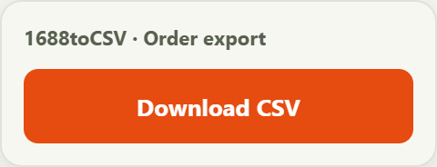

# 1688toCSV

A local order library for 1688: collect multiple orders, reconcile changes, and copy a five-column spreadsheet into Excel with separate product pictures. No CSV download is needed for the spreadsheet workflow.

<a href="screenshots/order-library.png"></a>

<details><summary>Dark appearance</summary>
<a href="screenshots/order-library-dark.png"></a>
</details>

## Install or update

Use **Node.js 24** and its bundled npm:

```sh
npm ci
npx playwright install --no-shell chromium
npm run verify
```

Load **dist** through **Extensions → Developer mode → Load unpacked**. In the Codex desktop app, extension controls are in **Settings → Browser → Extensions**. After every rebuild, **reload the extension and refresh the 1688 tabs**. The repository root is source, not the installable build. Version 2 adds permissions for its database, import tabs and clipboard; review the browser's update prompt if shown.

## Collect orders

1. Open your 1688 purchased-orders list and set date, status and search filters.
2. Tick the website's order checkboxes and choose **Import selected**. This is the primary action.
3. For a deliberate bulk collection, expand **More import options → Import all matching…**, review the order/page counts, then confirm. Changing filters invalidates that confirmation.
4. Keep the list tab open during discovery. Progress, errors, and **Pause import** are visible on the list itself. **Spreadsheet ↗** opens the full library page; there is no extension popup.

The importer reads complete detail pages, one at a time, reusing one **visible** tab. This supports the Codex embedded browser, which rejects extension-created background tabs. The reader closes when collection finishes or pauses; tabs you navigate elsewhere are left open. List cards can hide most products, so they are used for discovery and completeness checks. Progress shows saved and failed orders. Pause/resume is available; a browser restart leaves interrupted jobs paused. Resuming a bulk job also requires confirmation. Changing filters or an unreadable page stops discovery instead of mixing results. Login and verification screens need your interaction.

**Import selected opens the detail pages automatically.** You do not need to open each order yourself. The current importer needs that reader tab to collect the full products and reconcile their amounts; selecting orders on the list only creates the queue.

If **Spreadsheet ↗** cannot show a new tab, choose **Open spreadsheet here** in the list controls. This opens the library in the current tab and keeps saved orders. Pause or finish any import using that tab first. A selectable spreadsheet address remains available if the browser also rejects navigation. A completed import and a failed attempt to display the spreadsheet are reported separately.

On a detail page, **Save order** adds that order. The extension icon and **Spreadsheet ↗** open the library.

If upgrading from 2.0.0 after seeing **“Owl extension-created tabs must be active”**, reload the extension and refresh the library/list pages, then resume the small selected-order job. Its queue is preserved; do not resume an old bulk job unless you intend to collect its full scope. Opening the spreadsheet does not itself prove any order was saved: check the saved count and progress error.

Version 2.0.2 fixes **“Discount total is missing or invalid”** for labelled or empty optional discount summaries. Product discounts still reconcile with the detailed order totals and payable amount. Slow-rendering detail pages use bounded retries, and tab lookup errors are reported separately from an actually closed tab. Existing failed queues can be retried after updating.

Version 2.0.3 fixes a cause of **“The CNY payable amount is missing or ambiguous”**: HTML comment markers surrounding the amount were being read as payment text. The parser now ignores those non-display nodes while retaining strict currency and amount checks. Browser import fixtures include these markers, which the saved offline captures did not retain around their totals.

Version 2.0.4 keeps spreadsheet-opening failures separate from saved-import progress and offers current-tab navigation even when the browser blocks creation of a new spreadsheet tab.

**Settings → Appearance** offers System, Light, and Dark. System follows your device; an explicit choice persists and synchronizes across library tabs. The list-page controls follow your device's color scheme.

## Copy to Excel

Columns are always **Thumbnail · Description · Price · Quantity · Discount**. Select orders, search/filter products, or tick individual rows. Without a product selection, copy includes **all filtered rows**, including those beyond the visible 100-row page.

| Action        | Result                                                                                    |
| ------------- | ----------------------------------------------------------------------------------------- |
| Copy to Excel | Five columns with separate thumbnail pictures                                             |
| Copy values   | Five columns, leaving Thumbnail blank for a separate image paste                          |
| Copy images   | One column of separate pictures for the selected products, orders, or all filtered orders |
| Copy image    | One larger PNG picture                                                                    |

Paste into a blank Windows Excel range. Bulk pictures are 20 pixels high to align with standard rows; resize after pasting. They are individual floating pictures, not a collage or a claim of Excel native in-cell image support. Descriptions retain every variant field with line breaks flattened for predictable alignment. Uncheck **Headers** when appending. Failed images report an error; **Copy values** remains available.

A local browser-to-Excel check verified five columns, eight separate pictures aligned with their product rows, and numeric Price/Quantity cells. Other spreadsheet apps and custom row heights need separate verification.

## Reconciliation and discounts

Use **Refresh all**, or select orders before refreshing. Visiting a saved detail page also refreshes it after a complete successful read. There is no scheduled background crawl. Full order and product-entry IDs remain strings; repeated products and reordered rows do not collide.

Only complete snapshots that reconcile with displayed totals replace stored data. Changes create a retained version and highlight affected rows. Click a seller to inspect totals, earlier values, and your separate notes/tags. Failed reads preserve the previous good version.

**Price** is the original unit price. **Discount** is the total reduction for the product row. An explicit **优惠共47.20元** stays an authoritative source discount of **47.20**. Whole-order **商品改价** is allocated proportionally after each product's own discounts, using exact cents and deterministic remainder rounding. Discount includes that allocation; order details retain the source and allocated amounts. Increases use a negative allocation. Shipping stays separate. Unknown financial fields and inconsistent totals need investigation.

Source status is preserved, including closed orders. Use the status filter to copy only completed purchases if desired. This release supports **one buyer account per local library**; automatic multi-account detection is not implemented.

## Local data and backups

Orders, history, notes, jobs and cached thumbnails remain in the extension's browser database. No developer server receives them. Importing uses the existing 1688 session; the extension does not extract passwords or authentication cookies, or submit, pay for, or change orders.

Thumbnails load from Alibaba's image CDN when displayed or copied and are cached by URL. **Back up** saves a versioned JSON file with records, history, notes and cached pictures. Unfetched pictures still need a connection. **Restore** validates the whole file before merging, preserves existing notes and chooses newer source observations. Import jobs are not restored. Removing orders removes their histories; shared cached pictures may remain. Uninstalling or clearing the profile can remove the library, so keep backups.

## Existing CSV export

The one-click **Download CSV** remains on detail pages. It preserves displayed **item discounts only**; the library's Excel copy additionally includes allocated whole-order adjustments. “Save requested” means the browser received the request, not that saving finished.

<a href="screenshots/1688toCSV-download.png"></a>

## Development and verification

| Command                           | Purpose                                                                                        |
| --------------------------------- | ---------------------------------------------------------------------------------------------- |
| npm run verify                    | Source/docs checks, unit tests, explicit production rebuild and isolated Chromium tests        |
| npm run build / npm run build:dev | Build the complete extension once into dist                                                    |
| npm run test:browser              | Test the current build with synthetic pages and a temporary profile                            |
| npm run test:excel                | Windows-only browser-to-desktop-Excel test; new unsaved workbook, clipboard restored afterward |
| npm run preview                   | Synthetic previews; open /library.html for the spreadsheet                                     |
| npm run screenshots               | Regenerate README images from synthetic data                                                   |
| npm run check:docs                | Validate links, screenshots and documented commands                                            |

No watch mode. Rebuild after source changes and regenerate screenshots for UI changes. Never commit private orders, exports, offline captures, profiles or credentials. The test manifest's localhost and inspection access do not ship.

The packaged import tests cover selection → tab navigation → extraction → persistent storage → spreadsheet → clipboard, plus failed-queue retry and delayed rendering. They substitute reserved `.test` domains in a disposable extension copy and fulfill every synthetic page locally; real network requests are blocked. On Windows with Edge installed, run them in PowerShell with `$env:EXTENSION_TEST_CHANNEL='msedge'; npm run test:browser -- tests/browser/import-flow.spec.mjs` and remove that environment variable afterward. Default verification uses Chromium.

Architecture separates page adapters, exact monetary calculations, IndexedDB reconciliation, persistent import orchestration and spreadsheet/clipboard UI. Extend adapters and synthetic fixtures for new layouts; keep selectors out of the library UI. Database and backup versions support future migrations.

Adapters were checked offline against two supplied list captures and three detail captures. Those private files are not fixtures. Live pagination/import in the embedded browser remains separate acceptance: mock tests and successful clipboard tests do not prove live-site behavior.

The 2.0.2 packaged extension also imported all 66 product rows from the three inert private detail captures in isolated Microsoft Edge; the five-row order retained its 47.20 item discount. That local replay does not establish live-site or embedded-browser acceptance.

[CI](.github/workflows/ci.yml) routes documentation-only changes to lightweight validation, code to full verification, and mixed changes to both. The stable **required** job rejects failures, cancellations and unexpected skips. Desktop Excel acceptance runs locally because hosted Linux CI has no desktop Excel.

See [AGENTS.md](AGENTS.md) for the workflow and separate CE Metadata contract, and [CHROMEWEBSTORE.md](CHROMEWEBSTORE.md) for draft metadata, permissions, privacy and unfinished publishing requirements. Repository delivery does not imply store submission.
