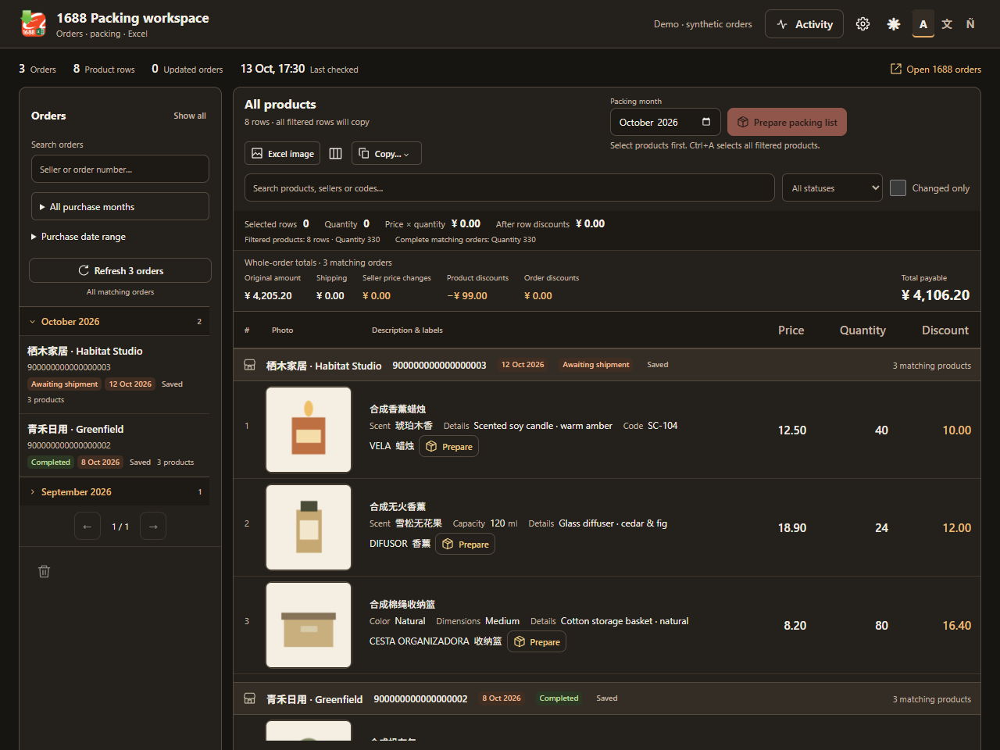
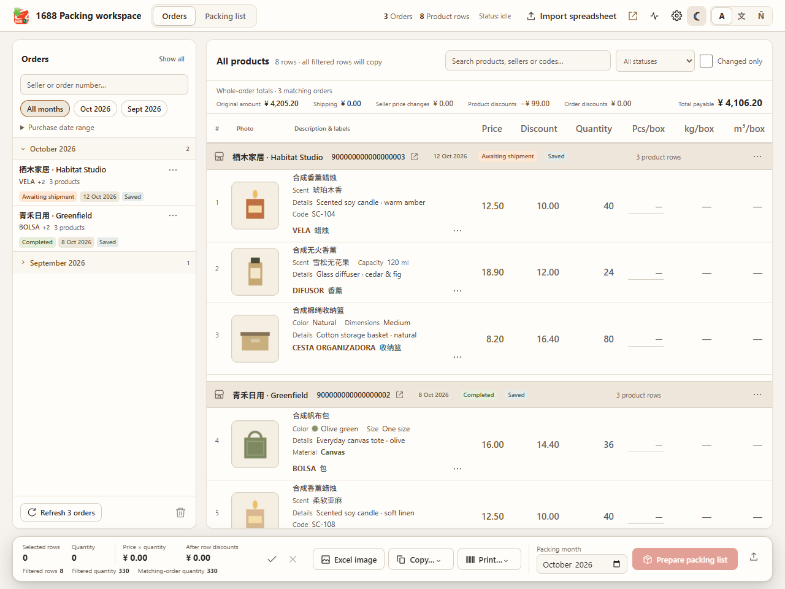
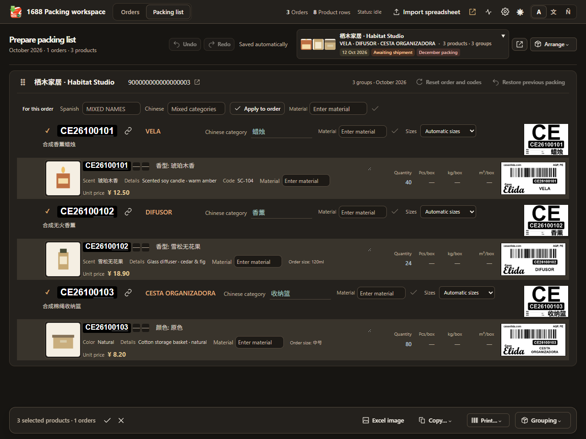
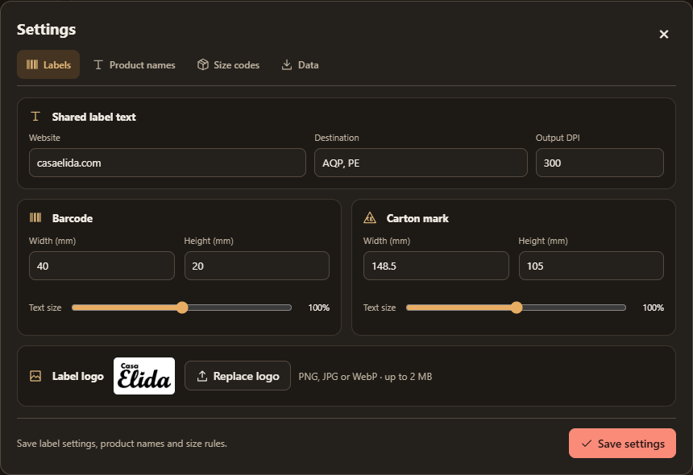
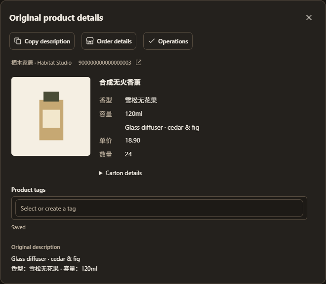
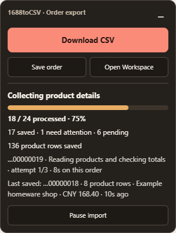
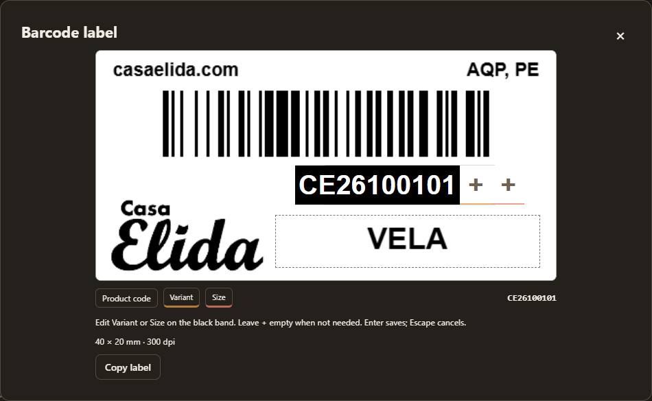
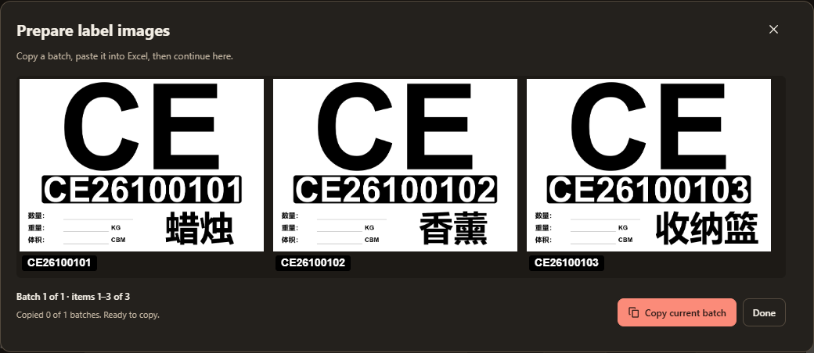

# 1688toCSV

Keep your purchases in the **1688 Packing workspace**, prepare product codes and labels, and copy what you need into Excel.

<a href="screenshots/order-library-dark.png"></a>

<details><summary>Light appearance</summary>
<a href="screenshots/order-library.png"></a>
</details>

## Install or update

With **Node.js 24** installed, run these in the repository folder:

```sh
npm ci
npx playwright install --no-shell chromium
npm run verify
```

Open **Extensions → Developer mode → Load unpacked** and select **dist**. In Codex, find extensions under **Settings → Browser → Extensions**. After an update, reload the extension and refresh your 1688 tabs.

## Import and prepare

1. Open your [1688 orders](https://work.1688.com/home/buyer.htm), tick the orders you want, and choose **Import selected**. Confirm the count and keep the list open while the import runs. The reader tab opens in the background, so the visible tab never changes. If 1688 asks for a sign-in or verification, the import pauses and the workspace shows one notice: choose **Open the 1688 tab**, finish the step, then **Resume import**. Browsers that reject background extension tabs read in a separate unfocused window; if that is refused too, the import pauses and asks before using a visible tab.
2. Click **Open Workspace**. If a new tab is blocked, use **Open Workspace here** after the import finishes.
3. In **Orders**, filter purchase months with the month chips, choose orders, then select the product rows to pack. **Ctrl+A** in the product table selects all filtered products across orders and pages.
4. In the action bar at the bottom, set **Packing month**, check the product/order count shown just above it, and choose **Prepare packing list**. Every newly assigned product—even a single product—first shows a review of its photos, packing month, proposed codes and naming/size/material helpers. Choose **Assign only** to save these values and stay in Orders with your selection intact, or **Assign codes and prepare** to continue to packing. Assign only is available when the selected sellers are identified and existing products are not moving months. Cancel leaves packing and code reservations unchanged. Reopening already assigned products is direct; moving existing codes also requires review.
5. Arrange groups and products, review names and labels, then copy from the selection toolbar docked at the bottom of the packing list. **Changes save automatically**. Use **Copy… → Back up packing** when finished.

The **Orders** and **Packing list** tabs at the top switch views. **Packing list** reopens the products already assigned to the packing month without changing your Orders selection; **Orders** saves packing edits first, then returns. Purchase-month filters start with the current month and remember your choice across reloads. **Packing month** starts at the current month whenever the workspace opens; it is independent of purchase dates. October purchases can therefore receive December codes. Only the selected products move; a partly selected group splits so its unselected products keep their codes. With no product rows selected, **Prepare packing list** reopens products already assigned to that packing month, across saved orders. It does not select purchases by date.

The main Orders list and Products table show purchases newest first, including their purchase time within a day. Products retain their source order inside each order; missing purchase dates appear last. Each successful import refreshes the open workspace immediately. A new order matching the current filters returns the relevant list to its first page, while filters and selected product rows remain intact. Your packing arrangement continues to control the preparation form and its exports independently.

For fees, price adjustments or other rows that should not enter packing, use **Skip packing** beside the product's preparation action. The compact icon appears on row hover or keyboard focus and stays visible on touch screens. A skipped product shows one small **Skipped** button instead of Prepare; click it to include that product again. The choice saves automatically and survives refreshes, reloads and backups. Batch preparation omits skipped products and shows eligible/skipped counts beside **Prepare packing list**; if every selected product is skipped, preparation is unavailable. Skipping keeps source amounts, product selection and any existing saved packing edits intact.

Long assignment, grouping, removal and conflict reviews keep their decision buttons at the top while product comparisons scroll underneath. Chosen columns and image-copy popups also keep their main actions reachable above long option lists. Short confirmations retain their compact layout.

<a href="screenshots/preparation.png"></a>

Known products receive Spanish names and Chinese categories automatically; unknown products stay unnamed. The **product code heads each group**, with its editable Spanish name and Chinese category below. Click photos to zoom and drag; **Previous/Next** browse the current filtered products across pages, or the displayed packing products in their arranged order. **←/→** change photos; **↑/↓** zoom in/out. **Page Up/Page Down** and **+/−** remain available. Edit label text and variant/size endings directly in the previews. Resolve uncertain size codes before copying. **Undo** and **Redo** retain preparation edits throughout the open packing session, including after autosave. This covers codes, names, categories, materials, grouping, removal, arrangement, size handling and reset/restore; multi-order changes undo together. Reloading starts a fresh history. Only currently assigned codes block reuse; edits from another tab must be reloaded before continuing. Invalid edits stay visible; returning to Orders waits for a successful save. Errors appear in small dismissible popouts with readable colors in either theme; code conflicts include a Resolve action and leave your draft intact.

Label previews hide as soon as their code becomes invalid or conflicts with another variant; click the message to resolve the conflict or reach the affected field. Unrelated valid labels stay visible. Changed codes show a brief checking state before their new preview appears.

Each variant shows its source **unit price and quantity**, without a discount field. Shared barcodes show the distinct unit prices and combined quantity of the source rows in the open packing. **Material** is suggested from clear seller wording when you prepare products; uncertain materials stay blank. Edit a product's material or apply a shared value to its group or order. Your manual values, including an intentionally empty value, take priority over later suggestions. Preparation displays its current stage and processed-product counts while updating names, sizes, colors and materials, then saving and opening the packing view.

Double-click a packing product, or press Enter on its row, to inspect and copy its original details. If one packing row represents several source products, choose the source in the popup. Both views use **74 × 74 px photos** with compact row spacing. A small 24px photo-copy control appears at the top corner only while hovering or using keyboard focus, and disappears when the pointer leaves even after a copy. Clicking the rest of the photo opens the viewer. Selection uses one subtle tint and check marks, without vertical selection lines. Updated and Saved rows share the same neutral background. Hover or focus actions for explanations of their scope and result; hover help closes when the pointer leaves.

Click groups to add or remove them from your selection without clearing other groups. **Arrange** offers **Store**, **Group code** and **Store, then group code** for the displayed packing orders. Orders remain intact; code sorting also arranges their displayed groups. Drag whole orders, groups within their order, or products within their group to refine the result. Arrangement saves automatically, keeps existing codes and controls every copy/export format. Hidden orders and groups retain their places. **Reset order and codes** restores that order's default grouping, order and codes while retaining names on matching groups; its preview identifies changes to positions and barcode endings, and the action is disabled when nothing would change. **Restore previous packing** restores the setup saved before its latest packing-month move, including that setup's names and codes. Both show the affected products before applying changes.

The selection toolbar combines your selected-product count, select-all/clear controls, copying and **Grouping**. Its grouping menu can share a barcode within each selected group, separate combined rows, move selected variants into new products, or merge complete groups from one order and packing month. Unavailable actions explain which selection they need. A photo/code review precedes changes; products from different orders are never merged. Each product group no longer repeats the same grouping buttons.

Small unboxed move and remove controls sit side by side at the far left of each group and product. They appear on hover or keyboard focus and stay visible on touch screens. **Remove group** and **Remove product** open a visual review directly. Repeated table headers and row numbers are hidden; a thin separator and compact spacing mark each new order. A warm row fill and plain check marks distinguish selection without photo badges or left-edge bars.

Removing a packing group or product first reviews its changes with photos and labeled before/after values. It discards that product’s edits from the current preparation session, including autosaved edits. Previously prepared products recover their session-start values; newly prepared products return to unassigned. Shared group changes affecting remaining products are also shown before confirmation. Empty orders disappear from the packing selector immediately. Undo/Redo restores both values and packing membership. Source orders stay intact.

Only **currently assigned** product codes and barcodes block reuse. Changing or removing an assignment releases its old code, even if that label was copied earlier. A product may return to its previous code if it is still free. The updated database removes inactive reservations automatically. **Resolve code** shows the current owning product and a colored, labeled before/after comparison for every affected barcode. Edit product/variant/size fields or stage **Undo code edits** / **Use next available code**, inspect the proposal, then choose **Apply corrections**. Failed corrections remain editable. **Keep saved version** discards all pending edits for that order. Session Undo/Redo and reset checkpoints retain values but do not reserve old codes; restoring a code now assigned elsewhere requires resolving that current conflict.

Packing errors identify the affected order, code, variant and photo when available. Their action opens the relevant resolver or reveals, focuses and briefly highlights the field to fix, including fields on another packing page. Missing categories, unresolved sizes and active code conflicts have specific recovery actions; an image-loading failure can retry its batch without changing the clipboard.

**Open selected order** (an external-link icon when the toolbar is tight on space) is enabled for exactly one chosen packing order and reuses one 1688 tab. Small external-link icons beside order identities open that specific source order. Main Orders cards keep the product count beside the order number, with compact wrapping status/date badges and colored tags below. Click a store name or full order number to copy it; a small **Copied** helper confirms success. The compact packing order selector shows up to six distinct product photos in a three-by-two mosaic, with scoped product/group counts, including in **All orders**. A single photo stays centered at 48 × 48 px. Its choices show the seller, saved Spanish names (Chinese categories in Chinese mode), purchase date and delivery status without repeating order numbers. Filtering changes which packing orders are displayed; copying uses selected products within those orders, while backup includes the whole open preparation. Orders marked **Seller unavailable** need a seller member login before label codes can be assigned.

**Settings → Product names** edits local naming rules; **Size codes** maps seller size names such as 小号 to endings such as S. Both tables have search and pages of 12. Measurements are compared automatically; unclear or mixed assortments stay for review. **Product colors** lets you search and edit seller aliases, English/Chinese/Spanish names and optional swatches, with eight rules per page. These helpers preserve original seller descriptions and saved label text. **Labels** holds shared text, dimensions, text size, image quality and logo. Click **Save settings** to apply changes.

Size suggestions compare complete, compatible measurements, including mixed units and named height, width, diameter or other axes. Two measured sizes receive **S/L**, three **S/M/L**, four **S/M/L/XL**, and five **XS/S/M/L/XL**. Every compared axis must agree on the order; partial dimensions, crossing measurements and unsupported assortments stay for review. Explicit names and your saved size endings take priority. For exactly two otherwise matching variants with unclear textual sizes, **Review size suggestions** may offer a price-based **S/L** proposal. Its photos, exact unit prices and before/after barcodes let you check it before applying; price alone never assigns a size automatically.

When a seller calls colors or styles “sizes,” choose **Sizes → No size difference** for that product group. A review appears only when barcode values would actually change, and shows only the affected variants. Recognition-only changes save quietly; A/B style endings remain. This exception persists without disabling size recognition elsewhere. Switch back to Automatic sizes to recheck the source, or type an explicit size ending to return to automatic mode while retaining your typed value. Equal complete measurements do not receive different size endings merely because their prices differ.

**Settings → Appearance** offers Warm orange, 1688 orange, Soft apricot and Terracotta palettes, chosen separately for light and dark mode. Customize date, delivery-status, Saved/Updated and Activity badge colors in each mode; text contrast adjusts automatically. Reset a badge to its palette defaults when needed. The header appearance toggle uses your saved light/dark choices. Floating import controls on 1688 also follow this palette and mode, including when the workspace is closed; printed artwork keeps its own colors.

Create reusable tags in **Settings → Appearance**, which has separate **Order tags** and **Product tags** sections. Order tags appear on order cards and in order details; assigned product tags appear in the Products table, with no empty tag control on untagged rows. Double-click a product to edit its tags in **Original product details**. The picker filters and ranks existing tags as you type; **↑/↓** moves through matches and **Enter** selects or creates a tag. Click a chip's **×** to remove that assignment. Both kinds of tags are searchable in their corresponding lists. Rename tags only in Settings: choose the pencil beside a tag, edit its name, then press Enter or the check mark. Existing tags update all their assignments and keep their colors; duplicate names are rejected rather than merged. A new, unsaved tag keeps its edited name when you save Settings.

Set tag backgrounds and text colors separately for light and dark mode, or use **Randomize colors** beside a tag or workspace label for another readable color pair in both modes. **Auto** restores readable text for the chosen background. Tags created in Settings remain available until first used; after that, removing their last assignment removes the unused tag automatically. **Delete globally** removes a tag and its assignments, with an affected-item count before deleting an assigned tag. Notes and tag assignments save automatically. Closing their editor also adds any typed tag and waits for pending changes; a failed save keeps the draft open with Retry. Leaving or reloading with unsaved annotations triggers the browser's exit warning.

<details><summary>Label settings</summary>
<a href="screenshots/settings.png"></a>
</details>

## Select, review and refresh

Click a row to select it; click it again to deselect. **Shift-click** selects a range, and **Ctrl-click** adds or removes individual rows. Buttons and photos work independently. Double-click an order, or press **Enter**, to open its details.

**Ctrl+A** selects all filtered entries across pages in the last Orders or Products list you clicked or focused; **Ctrl+D** clears that list's selection. In packing, these shortcuts select or clear the displayed packing scope across pages. While editing a text field, normal text selection stays available and neither shortcut changes product selection.

Hover or focus a control to see its shortcut alongside its current explanation. Workspace shortcuts work outside text fields and pause while a dialog is open. They invoke the same enabled actions and confirmations as clicking; **Ctrl+Enter** never bypasses assignment review.

| Shortcut                                    | Action                                 |
| ------------------------------------------- | -------------------------------------- |
| **Ctrl+Enter**                              | Prepare packing list from Orders       |
| **Alt+Shift+C**                             | Open the Copy menu                     |
| **Alt+Shift+E**                             | Open Excel image preview               |
| **Alt+Shift+F** / **Alt+Shift+R**           | Focus product / order search in Orders |
| **Alt+Shift+S** / **Alt+Shift+T**           | Open Settings / Activity               |
| **Alt+Shift+I**                             | Restore a packing file from Orders     |
| **Alt+Shift+B**                             | Back up the whole open preparation     |
| **Alt+Shift+O**                             | Return from Preparation to Orders      |
| **Alt+Shift+A** / **Alt+Shift+G**           | Open Arrange / Grouping in Preparation |
| **Ctrl+Z** / **Ctrl+Y** or **Ctrl+Shift+Z** | Undo / redo preparation edits          |

Existing Escape, photo navigation/zoom and Ctrl+A/Ctrl+D behavior remains available in its own context. Browser copy/paste, Find, Print, Save and Reload shortcuts are not reassigned.

Product rows show translated attribute labels, recognized sizes, materials and color helpers in your interface language. Source titles, model numbers and unfamiliar seller wording stay intact. Click an attribute to copy its displayed value; clear measurements keep their unit visible beside the copyable number. Double-click a product row, or press **Enter**, for **Original product details**: copy each original value or the complete source description, inspect/copy the photo, or open its order details. These helpers do not change the source data or saved packing names. Excel images use the display translations; source-value exports retain the original text.

Casa Elida codes use bold white text on a rounded black background in Products, packing editors, label previews and conflict reviews. One approved design defines the clear space and corners relative to the actual text size, including printed barcode labels, shipping carton marks and the designer. Contextual font sizes remain: compact in Products, larger while editing. Spanish product names, Chinese categories, materials, quantities and prices use distinct readable foreground tones in every theme. In English and Spanish, order cards show the first distinct Spanish product name beside the store, followed by **+N** for additional names; hover or focus the summary to see them all.

The Products table also shows the saved packing material, or a confident source suggestion when none is saved. Click the material to copy it; a deliberately cleared packing material stays blank instead of reappearing as a suggestion.

<details><summary>Original product details</summary>
<a href="screenshots/product-details.png"></a>
</details>

Filter one or more purchase months; **Shift-click** filters a month range. Month chips use short names; the seven most recent months are shown, and **+N months** shows the rest. Click a month heading to collapse its orders. The current month starts expanded. Seller/order search, product search, status and date filters update the summary above the products table: it counts each complete matching order once, including its shipping and order discounts.

Orders, Products, Product names, Size codes and Product colors searches offer local suggestions. Use **↑/↓** and **Enter** to choose one, or **Escape** to dismiss suggestions. Text searches tolerate a small spelling mistake in longer Latin words and ignore accents; IDs, codes, measurements and Chinese text require the characters you type to match literally, including partial searches. Products search also includes recognized translated attributes and saved materials. Nothing is sent to a search or translation service.

Whole-order totals sit above the products table; the live selection summary is at the left of the action bar at the bottom. The selection summary shows selected rows, quantity, item amount and the amount after saved item discounts, alongside displayed-product and complete matching-order quantities. It follows selection and filters across pages. Selection amounts exclude shipping and order-only discounts; those stay in the whole-order totals. Clearing selection shows zero selected items.

Store-order bands separate the products with the seller name, full order number, date, delivery status and matching-product count. These details appear once per order, rather than in every product row. The heading backgrounds and spacing remain distinct when rows are selected and do not enter copied data or selection ranges. **Updated** means a refresh changed saved order data at least once; **Saved** means the initial saved version. Both are saved successfully, and neither badge tracks whether changes have been reviewed.

Use the contextual **Refresh** action for selected orders or the current filters. Full-library refresh is in **Settings → Data**. Multi-order imports and refreshes confirm their scope before starting; copying needs no confirmation. A small colored badge on **Activity** distinguishes ongoing imports from unread completed, paused or failed updates; the button itself stays neutral. Opening it marks the displayed updates as read; ordinary progress ticks do not create new notifications. It holds progress, Pause/Resume and **Save import report**. The floating controls on 1688 list/detail pages can be minimized to a compact progress strip while the import continues; restore them to reach the full controls. Retry preserves successful saves.

<details><summary>Import progress</summary>
<a href="screenshots/import-progress.png"></a>
</details>

## Copy into Excel

In Orders and Prepare packing, **Excel image** is the direct action. **Copy…** opens the other formats in one compact panel; source values/photos and packing values are clearly grouped. **Headers** is inside this panel. In packing, its **Backup** section also holds **Back up packing**, while **Restore packing** is the upload icon in the Orders action bar. Click outside or press Escape to close a panel. Clicking a product code copies it directly; the barcode and carton icons open their editors.

| Action                                          | Result                                                                                                |
| ----------------------------------------------- | ----------------------------------------------------------------------------------------------------- |
| **Copy values**                                 | Five source columns: photo placeholder, description, price, quantity and discount                     |
| **Copy images** / **Copy to Excel**             | Separate pictures, or the source columns with pictures                                                |
| **Copy Excel image**                            | One table picture in your selected language, with your chosen columns and order                       |
| **Copy preparation columns** / **Copy columns** | Your chosen packing and source columns, including Size and Size code; one base code per product group |
| **Copy group codes**                            | One base code per group                                                                               |

Bulk product photos, Excel cells with photos, Excel table images, barcodes and carton marks all open the same preview popup. Choose **Copy current batch**, paste into Excel, then return to the open popup. To copy just one picture, hover over it or focus it with the keyboard and use the small copy icon at its top right. Each individual copy confirms success on that image and preserves the original export quality; barcode and carton copies also retain their label dimensions for Excel. The popup stays open, and copying one image does not mark the whole batch as copied. Use **Previous batch**, **Next batch** or a numbered button to review another batch; check marks show which complete batches you have copied. Changing batches only changes the preview. Progress and errors stay inside the popup, where failed previews or copies can be retried. **Done**, **Close** or Escape ends the session. Copy buttons keep their size while working and showing success.

**Chosen columns** has 45 searchable fields grouped into **Codes & packing**, **Product details**, **Amounts**, **Order & supplier**, and **Tags & links**. Check fields to add them, then use the arrows in **Paste order** to arrange the columns. The original seven default columns are unchanged; new fields start unchecked. Choices, column order and **Headers** are remembered across copying, both views and reloads. Headers follow the workspace language; source text and saved values remain unchanged, and unavailable fields stay blank.

**Size** copies the saved packing size or the original size/specifications for an unprepared product. **Size code** copies only the assigned barcode ending, such as S or XL. Measurements, units and leading zeroes remain intact; an unassigned ending stays blank. Product tags belong only to that product. Whole-order amounts, including shipping and payable totals, repeat on each product row and must not be summed as product subtotals. Links are limited to the saved order, store and photo addresses.

Orders and Preparation share the same **Copy…** menu: Values, Product photos, Excel cells, Chosen columns, Group codes, Barcodes, Carton marks and Headers. **Excel image** remains the quick action beside it. Order labels are available after every product in the copy scope has a saved preparation. Orders-view copy actions use selected product rows, or all filtered rows when none are selected. In **Prepare packing list**, copying and grouping use only selected groups or products in the displayed orders and are disabled with no selection. **Back up packing** is available only in Preparation and covers the whole open packing, independently of selection. The toolbar is docked at the bottom of the packing list and wraps on narrow screens. **Ctrl+A** selects all products in that packing view. **Headers** starts off and remembers your choice, as do the column choosers. The preview keeps the products selected when you opened it. Every copy control confirms a successful clipboard write with a brief **Copied** state; image-copy popups confirm the current batch immediately and keep the other batches available. Pictures paste as floating images.

**Copy Excel image** is available in both views. **Excel image columns** sits beside the image preview in the same popup and collapses on narrow screens. Click to include or exclude a column, drag it or use the arrows to move it; the preview updates automatically. Choices save automatically and apply to both views, including after reopening or reloading. Changing columns starts a fresh set of batches and clears their copied markers. **Supplier details** adds blank carton dimensions, weight (kg) and carton-number cells for your supplier; these start enabled and can be excluded.

**Style & details** offers Neutral, Warm, Sage, Ink or a custom accent, with readable header text and thin order separators. Choose which order details appear—store, number, purchase date, status and order tags—and which description details appear—title, specifications, article number and product tags. Unavailable details explain why they cannot be enabled. Tags, dates and status badges retain their assigned workspace colors and rounded formatting in the image, using the current light or dark mode. These choices are remembered separately from the columns; **Reset style & details** leaves column selection and order intact. Turn off **Show store and order details** to hide every order-heading detail while keeping compact separators between purchases.

Scroll over the Excel-image preview to zoom, then drag the enlarged image to inspect it. **−**, **+** and **Fit image** provide the same controls without a wheel. Preview zoom never changes the copied image's dimensions. Shaded headings and thin separators keep different purchases distinct while preserving the spreadsheet grid, including across batches.

Headings and recognized description, category and material wording follow the workspace language. Source titles, unknown wording and your carton-mark artwork remain intact. **Category & material** places the material in bold beneath the category. Photos, numeric values and code endings remain prominent and centered. Consecutive variants sharing one carton mark use a merged cell with the actual image, without a repeated code caption. Including carton marks requires a Chinese category for prepared CE codes; omitted photos and marks do not need to load. Missing required data or failed images leave the clipboard unchanged. Manually reordered barcode base codes appear blue. Large tables offer numbered batches, repeating a shared mark when a group crosses a batch boundary. Barcode and carton-mark pictures also have their own copy actions.

Carton previews sit beside each group's names in a compact 100px-wide area, without a repeated text caption; click the image to edit the full label. Barcode and carton codes use fitted, softly rounded black backings in the editor and copied labels. Carton codes are slightly smaller and centered, retaining the full code string and the same geometry in the editor and generated image. Authored variant and size endings stay inside the rounded barcode strip with visible inset focus; empty ending controls sit beside it so they do not shift the printed code. Barcode bars and physical label dimensions remain separate from the preview layout.

<a href="screenshots/label-editor.png"></a>

<details><summary>Copy batches without leaving the preview</summary>
<a href="screenshots/copy-label-batches.png"></a>
</details>

## Print labels and carton marks

Select prepared products, then choose **Print… → Print labels…** or **Print carton marks…** in Orders or in the packing toolbar. The dialog lists each product with an editable quantity and shows labels per A4, pages, and the requested, extra and final counts. The preview shows every page with its products; use the arrows to move between pages. **Export PDF** downloads the file offline, named like `CE-labels-2026-10-19-153012-3-products.pdf` (date and time), with a JSON summary of its products and orders next to it. Print it at **100% (Actual size)**.

Labels use the barcode size from **Settings → Labels** (40 × 20 mm gives 70 per A4 with 5 mm margins). They turn 90° only when that fits more. Requested quantities always print, on as few pages as possible, with each product kept together in the selected order. Spare places on the last page are shared by quantity: 40 and 50 labels at 100 per page print 44 and 56. A warning appears when extras are more than 25% of the request. **Advanced** offers sharing equally, leaving spares blank, a maximum number of extras per product, and gaps between labels. Cut guides, a small per-page summary line and optional marks where products change never cover barcodes or text.

Carton marks print two per A4, one in each half, with a cut guide in the middle. Each product starts at one carton (packing data records no carton count yet). Optional **Carton n of N** numbering and an extra copy for an odd last half are available.

**Calibration sheet** prints rulers (10 mm and 100 mm on both axes) and two reference crosses. Measure them, enter **Offset X/Y** (−5 to +5 mm) and save the margin and offsets as a named A4 preset. Labels and carton marks remember their own settings. A warning appears when content would land closer than 4 mm to a paper edge.

**Print… → Recent print jobs…** keeps the five most recent exports. To reprint exactly, print the saved PDF again. **Regenerate** builds a new PDF from current product data with the same quantities and settings, and notes that product data may have changed.

## Automation

An automation agent can run imports, packing-list exports and printing through stable `data-action` controls, read the workspace status line, and check a JSON summary saved next to every export. See [docs/automation.md](docs/automation.md).

## Keep your data

Use **Settings → Data → Back up** for the complete library. **Copy… → Back up packing** in Preparation exports every group/product in the open preparation, including other pages and order filters; it works even with no selection. Removed products and unrelated orders, images, source history, allocations and global vocabularies are excluded. Complete source orders remain dependencies so monetary totals validate; only photos for the packing's products, current assignments, scoped restore checkpoints, label settings/logo and assigned tag colors travel with it. A photo-heavy packing can still produce a large file.

Choose **Restore packing** (the upload icon after **Prepare packing list** in the Orders action bar) to review a packing file and open its saved scope without assigning new codes. This action is unavailable inside an active preparation. Newer local edits, unrelated packing products and existing global settings are kept; label settings can initialize an empty library. Saved preparation names and materials survive scoped restore, workspace reloads and reopening. Automatic names change when you explicitly edit their naming rules; unrelated settings changes keep the saved text. Full-library backups, including global naming/size/color rules and appearance, still belong in Settings. Restore rejects conflicting current ownership without partially importing the file; older backups cannot revive inactive assignments. Refreshes preserve edits. Use one buyer account per library.

Data and naming rules stay local; there is no online translation service. Beside the sun/moon appearance toggle, **A / 文 / Ñ** switches the interface between English, Chinese and Spanish and remembers your choice. Display helpers and Excel-image headings use this language; original seller descriptions and saved label names remain unchanged. Switching language keeps open edits. The active light/dark mode, language, filters, copy choices and Activity read state are browser preferences, separate from library backups; a floating panel's minimized state lasts for its browser-tab session. Press **Escape** in packing to return to Orders after autosave; unresolved errors keep your edits open. The detail-page **Download CSV** remains available.

See [development notes](docs/development.md) for calculations, code allocation and testing, and [store preparation](CHROMEWEBSTORE.md) for permissions and publication status.
