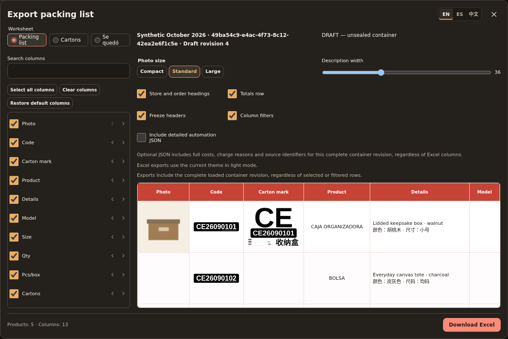

# 1688toPL

Turn 1688 purchases and supplier spreadsheets into packing lists, product barcodes and carton marks. Keep orders and photos in your browser, prepare them in one workspace, then copy into Excel or download an editable workbook.

<a href="screenshots/order-library-dark.png"></a>

## Install or update

Install **Node.js 24**, then run these commands in the repository folder:

```powershell
npm ci
npx playwright install --no-shell chromium
npm run verify
```

In your Chromium browser, open **Extensions → Developer mode → Load unpacked** and select **dist**. After updating, reload the same extension and refresh open 1688 tabs. Keep the same installed folder and extension ID to retain your library. Existing owner installations use the [local development workflow](docs/development.md#local-development).

## 1. Add your orders

Click the **1688toPL** extension icon to open the workspace, then choose a source:

- **1688:** open your [orders](https://work.1688.com/home/buyer.htm), tick the purchases, choose **Import selected** and confirm the count. Keep the list open. If sign-in or verification is needed, choose **Open the 1688 tab**, finish it yourself, then **Resume import**.
- **Supplier workbook:** choose **Import spreadsheet**, download the template or [mark your workbook](docs/store-spreadsheets.md), then review its date, photos, quantities and total. A matching-content warning lets you check an earlier import before deliberately creating another purchase.
- **Other purchases:** choose **Add order**, enter the supplier, reference, date and products, then **Save order**. You can also [import an order JSON file](docs/automation.md#orders-from-other-sources).

[Importing and finding orders](docs/importing.md) explains filtering, refresh and recovery.

<a href="screenshots/store-spreadsheet-import.png"></a>

## 2. Prepare a packing list

1. In **Orders**, filter purchase months, choose orders and select product rows. **Ctrl+A** selects the full filtered product list.
2. Set **Packing month** in the bottom action bar. It controls your product-code month independently of the purchase date.
3. Choose **Prepare packing list**, review the photos and proposed codes, then **Assign codes and prepare**. **Assign only** saves eligible assignments while keeping you in Orders.
4. Review names, materials and variant/size endings. Changes save automatically. Use **Organize** to arrange or remove products, and **Undo / Redo** to correct edits.

Enter **Pcs/box** beside Quantity for immediate carton planning: **150 pieces ÷ 10 = 15 calculated cartons**. Use **Cartons** only when recording physical contents, measurements and received/loaded counts. See [packing and codes](docs/packing.md) and [cartons](docs/cartons.md).

<a href="screenshots/preparation.png"></a>

## 3. Copy, export or print

- **Excel image** copies a table picture. **Copy…** offers values, separate photos, chosen columns, barcodes and carton marks. In each image preview, choose **Copy current batch**, paste into Excel and return for the next batch.
- **Export packing list** downloads an editable workbook with **Products** and **Cartons** sheets. Choose all packing products or your selection, then columns and layout. **Include detailed automation JSON** starts off; enabling it adds full costs, reasons and source identifiers independently of the workbook columns.
- **Print…** creates label or carton-mark PDFs. Print at **100% / Actual size** and use the calibration sheet before relying on physical dimensions.

Read [Excel and export options](docs/exports.md), [printing](docs/printing.md) or the [keyboard shortcuts](docs/keyboard-shortcuts.md).

<a href="screenshots/packing-export.png"></a>

## 4. Back up your work

Use **Copy… → Back up packing** for the whole open preparation, or **Settings → Data → Back up** for the complete library. Both download lossless **`.json.gz`** files. Restore accepts these directly and older `.json` backups.

Keep a full backup before moving computers, uninstalling or clearing the browser profile. Use one buyer account per library. [Backup and restore](docs/data-and-backups.md) explains scope, photos, merge rules and recovery.

Orders, local rules and label generation stay on your device. Importing uses your signed-in 1688 session; uncached product photos may load from Alibaba CDN. There is no online translation or developer upload.

[All documentation](docs/README.md) · [Settings and photos](docs/settings-and-photos.md) · [Store operations and costs](docs/operations.md) · [Development](docs/development.md)
