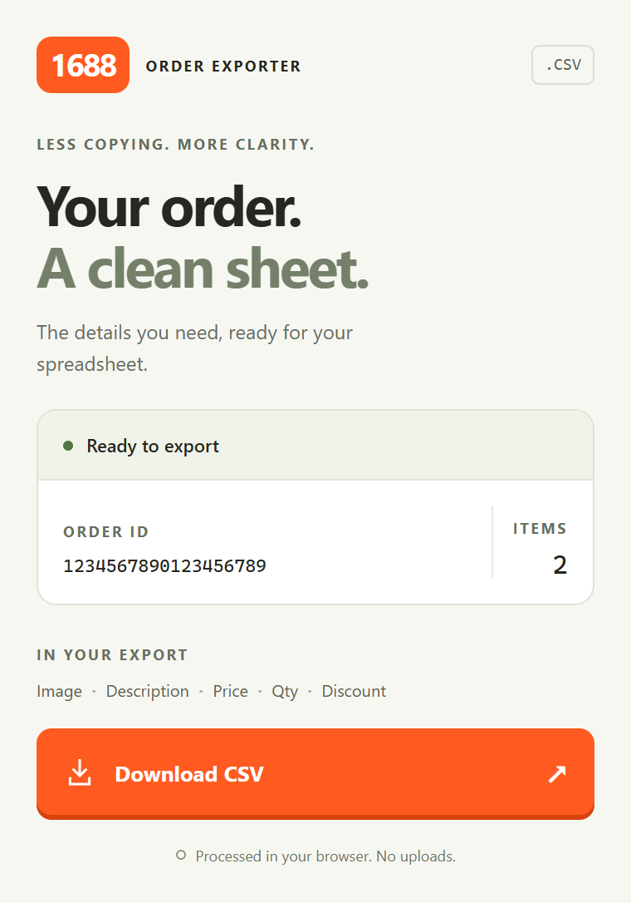
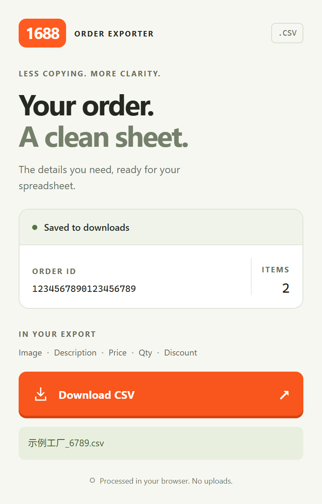
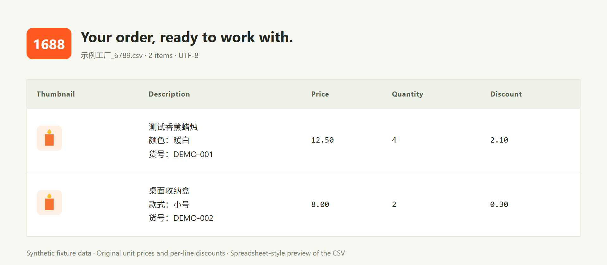

# 1688toCSV

Export a 1688 order detail page to a CSV with product descriptions, original unit prices, quantities, and item discounts. Chinese text and spreadsheet-friendly CSV escaping are preserved.



## Set up and install

Use **Node.js 24** and its bundled npm. From the repository folder:

```sh
npm ci
npx playwright install --no-shell chromium
npm run verify
```

Verification checks source and documentation, runs regression tests, builds the complete extension into `dist`, and tests the built extension in Chromium.

In the desktop app, open **Settings → Browser → Extensions**, enable **Developer mode**, click **Load unpacked**, and select the repository's **`dist` folder**. In Chrome, the same controls are on `chrome://extensions`.

If you previously installed the repository root, remove that old extension entry before loading `dist` to avoid duplicate copies. The root [manifest.json](manifest.json) is a source file; `dist` is the installable extension. Load `dist` once, then use its **Reload** control after subsequent builds.

## Export an order

1. Open a 1688 **order detail** page, not the purchased-orders list.
2. Open the extension and wait for **Ready to export**.
3. Click **Download CSV**. The filename uses the seller name and order suffix.





All screenshots use synthetic data. The extension reads the open order page; it does not submit or change the order.

**Calculation limitation:** the whole-order price adjustment, **商品改价**, is not allocated proportionally across product discounts. Item-level discounts are exported; whole-order adjustment allocation remains outstanding.

## Development cycle

After a requested code change, the agent explicitly runs **`npm run verify`** to rebuild and test the final candidate. There is no watch mode. For UI changes, the agent also regenerates the screenshots and checks the documentation.

| Command                | Purpose                                                                                    |
| ---------------------- | ------------------------------------------------------------------------------------------ |
| `npm run verify`       | Source and docs checks, regression tests, production build, and Chromium extension tests   |
| `npm run build`        | Build a complete production extension into `dist`                                          |
| `npm run build:dev`    | Build once with development output                                                         |
| `npm run test:browser` | Test the existing `dist` build in Chromium                                                 |
| `npm run preview`      | Serve a local popup preview with synthetic UI states; open the URL printed in the terminal |
| `npm run screenshots`  | Regenerate the ready, success, and CSV screenshots above from synthetic data               |
| `npm run check:docs`   | Validate local documentation links, screenshots, and documented package scripts            |

After every rebuild, **reload the installed extension and refresh the order page** before testing a download. Browser content scripts from the previous build otherwise remain in the open page.

The automated browser smoke test runs in a separate temporary Chromium profile. It uses a **test copy** of the built manifest with localhost access and an adapter that points the popup's active-tab lookup at a synthetic order tab. Extraction, content-script messaging, and downloading then use the real extension code and Chromium APIs. The installed package keeps its production manifest. This test does not use a normal browser profile or access live 1688 orders.

The preview exercises UI states using simulated browser APIs. A successful preview is not a live export test. If browser policy prevents the agent from accessing 1688, the user completes the reload, refresh, and download step; the agent can inspect the resulting CSV or error. Report automated test results and live-site acceptance separately. Never commit private order data, exports, or unsanitized page fixtures.

## GitHub checks

[CI](.github/workflows/ci.yml) runs on pull requests, pushes to `main`, and manual dispatch. Complete Git diffs route each change:

| Classification        | Checks                                                                    |
| --------------------- | ------------------------------------------------------------------------- |
| Documentation only    | Lightweight documentation validation without installing dependencies      |
| Code or unknown paths | Locked dependency install and full verification, including Chromium tests |
| Mixed                 | Both documentation and code checks                                        |

Manual runs and unavailable comparisons run both routes. The stable **`required`** check passes only when every routed job succeeds; required jobs that fail, cancel, or skip make it fail. CI routing does not manage repository labels or Projects.

See [AGENTS.md](AGENTS.md) for the standing development process and the separate CE Metadata cooperation contract.
