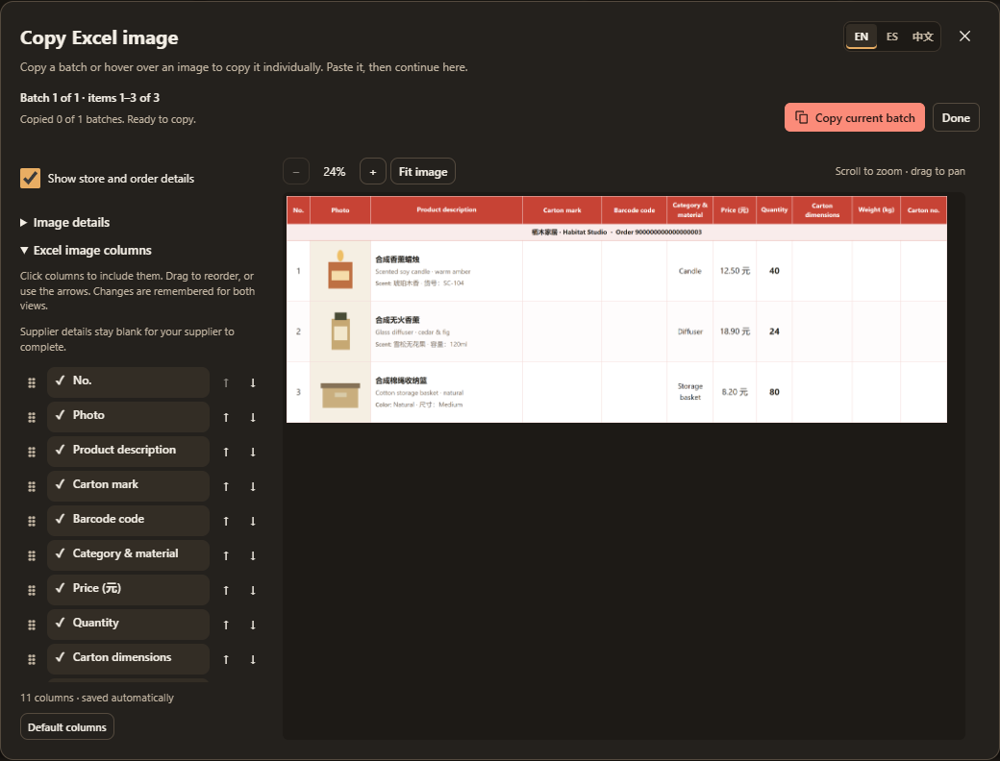

# Copying and exports

[Documentation](README.md) · [Packing](packing.md) · [Printing](printing.md)

## Choose scope and format

Orders provides source/product copying and **Excel image**. Orders copies selected source rows, or all filtered rows when none are selected. Packing copies or prints an explicit selection from a container revision; a partial selection is labelled as partial. **Ctrl+A** includes offscreen rows in the current logical display scope. The container workbook always covers the complete loaded revision, independently of that selection and display filters. Restorable backups are separate from both outputs.

The preview freezes its source rows or container revision when opened; later selection/filter changes do not replace it. Packing products, label text and photos are read-only revision evidence. Use **Edit in Orders** for current product authoring. Every copy control confirms success only after writing the clipboard. Failed image loads or validation leave the clipboard unchanged.

| Action                                    | Output                                                                          |
| ----------------------------------------- | ------------------------------------------------------------------------------- |
| Copy values                               | Five source columns: photo placeholder, description, price, quantity, discount. |
| Product photos / Copy images              | Separate floating pictures.                                                     |
| Excel cells / Copy to Excel               | Source columns with floating pictures.                                          |
| Chosen columns / Copy preparation columns | Selected packing/source fields in your chosen order.                            |
| Group codes                               | One base code per product group.                                                |
| Barcodes / Carton marks                   | Generated label pictures with physical dimensions.                              |
| Excel image                               | One table picture per preview batch.                                            |

**Headers** starts off and is remembered. Text-column choices/order are shared between views and survive reloads. They are separate from image columns and workbook export options. **Chosen columns** groups searchable fields under Codes & packing, Product details, Amounts, Order & supplier, and Tags & links. Use arrows in **Paste order** to arrange checked columns. New fields start unchecked.

**Size** is the saved packing size or original unprepared size/specification; **Size code** is only an assigned barcode ending. Measurements, units and leading zeroes stay intact. Product tags belong to their source product. Whole-order money repeated on product rows must not be summed as product subtotals. Source-value copying retains original text; translated display helpers are presentation only.

## Copy pictures in batches

Bulk photos, Excel cells, table images and labels use one preview dialog. Choose **Copy current batch**, paste into Excel, then return to the open popup. Previous/Next or numbered buttons change previews without copying; check marks identify completed batches. **Done / Close / Escape** ends the session. Retry appears in the popup after a failed preview or write.

Each image also has a small top-right copy button on hover or keyboard focus, always available on touch. It copies that prepared image at export quality and confirms success without marking the whole batch copied. Barcode/carton copies retain their physical dimensions. Clicking the rest of a source photo opens its viewer.

Photos paste as floating pictures. Standard-height Excel rows are the verified bulk-copy layout; custom heights, other spreadsheet apps and native in-cell conversion need separate checks. Individual source photos preserve their original pixels; bulk copies use smaller display sizes. Cached photos work offline; missing originals still require a connection.

## Excel table images

**Excel image columns** sits beside the preview and collapses on narrow screens. Check fields, drag or use arrows to reorder, and inspect the updated preview. Changes save automatically for both views. A column change starts new batches and clears copied markers. **Supplier details** adds blank dimension, kg and carton-number cells for your supplier; these start enabled.

**Image details** independently controls store/order identity, date, status, order tags, title, specifications, article number and product tags. Unavailable fields explain why. Resetting details preserves columns; hiding all store/order details retains purchase separators.

Headings and recognized categories/materials/attributes follow the popup's **EN / ES / 中文** choice. Source titles, unknown seller wording and saved label text stay intact. **Category & material** puts material in bold below category. Spreadsheet descriptions use larger, fuller wrapping; 1688 descriptions retain compact text. Photos fill square cells without stretching. Consecutive variants with the same carton mark share its actual image; it repeats at batch boundaries. Included CE carton marks need a Chinese category. Omitted photos/marks do not need loading.

The image uses the selected workspace theme's light palette, with saved light tag/status colors. Code badges retain the black/white design and product-number underline. Scroll to zoom, drag to inspect, or use **− / + / Fit image**; zoom never changes output dimensions. The copied picture remains resizable in Excel. Shaded store/order headings separate purchases without entering source data.

## Packing workbook

**Export packing list** opens a preview for the selected container revision. It exports all loaded products and physical cartons even when the screen is filtered or only a few rows are selected. Choose columns/order, photo size, description width, store/order headings, totals, frozen headers and filters. The preview is a sample; the download retains complete logical membership. Layout preferences remain optional and persist across reloads.

The editable XLSX has three localized sheets:

- **Packing list:** loaded source-line quantities, photos, codes, names, prices, discounts and carton references. Source unit price remains available. Separate purchases sharing barcodes retain separate financial rows. Partial freight/charge allocations are disclosed and reconcile across shipments rather than repeating full-order charges.
- **Cartons:** one row per loaded physical identity, with its reported or internal reference, actual mark, supported contents and measurements. Product references link to these rows. Each physical carton counts once even when several products participate. Genuine combined batch facts appear as combined evidence; unknown individual contents, kg or CBM stay unknown.
- **Se quedó:** the frozen remainder of this revision's included purchases, distinguishing known left-behind cartons from unprepared/unassigned goods. It excludes untouched orders and later purchases. Subsequent shipments change global Backlog without rewriting this historical sheet.

Every sheet identifies the container and revision. Unsealed output is prominently **DRAFT**; amendments have a new revision identity, and earlier revisions remain available. Names, label settings and referenced original photos come from the frozen revision. Operator-confirmed supplier identity is explicitly labelled as authored evidence.

Product participation does not duplicate physical totals or attribute an entire mixed carton to one purchase. [Capacity rules](cartons.md#review-and-output) preserve supported numeric evidence without inferring uniform contents from divisibility. Unknown values stay blank, explicit zero stays numeric, and a combined batch weight does not imply a partial loaded weight. Product kg/CBM attribution is labelled allocated and conserves the physical totals. Measurement warnings disclose incomplete coverage.

Money and measurement units use native numeric formats. Formula inputs retain unrounded values; omitted/reordered dependencies use valid formulas or exact cached results. Full descriptions remain editable with bounded wrapping; 1688 Details uses left-aligned 10pt text and spreadsheet descriptions remain centered. Square photo rows, standard code artwork and carton marks use the selected theme's light palette. Small embedded photos do not replace originals in the library. Identical artwork is reused across worksheets while repeated cells remain visible.

### Detailed automation JSON

**Include detailed automation JSON** starts unchecked whenever you open an export. Without it, Download Excel saves only the workbook. Enable it for the export when you want the companion machine-readable file.

Its scope is **the complete selected container revision**, including its frozen Se quedó, and its fields include **full costs, additional/feature/linked-payment charge amounts and reasons, source identifiers and physical coverage**. It identifies the actual workbook filename, container and revision. Excel column selection does not redact this JSON. For example, a Product + Quantity workbook can still have detailed costs in the optional JSON. It is a summary, not a restorable backup. Review the [summary contract](automation.md#export-files) before sharing either file.

The detailed `costEvidence` distinguishes original source-order charges, source-unit feature costs and reviewed payment evidence from this revision's allocated amounts. It retains reasons, supporting identifiers and the disclosed allocation basis/budgets from the frozen revision; it does not recalculate historical amounts from current product edits.

The browser download folder receives time-stamped files containing the container and revision identity; draft filenames begin with `DRAFT-`. Optional JSON shares the workbook stem. Same-second repeats receive `-2` and so on. Writing into an existing open workbook is not implemented.

On **Cartons**, known editable dimension columns retain the trusted cm-to-m³ formula only when its exact result agrees with the original cached volume. Historical discrepancies keep their literal frozen caches without recalculation. Hidden dimensions, unknown measurements and values beyond Excel's numeric precision keep their exact frozen values without an invented formula. Combined supplier evidence remains separate; it is not divided among unknown boxes. Workbook edits do not change the library or its sealed revision.

Container label and carton-mark PDFs also mark every draft page **DRAFT — unsealed / unverified** and use a `DRAFT-` filename. Their companion JSON retains the container ID, `revisionId: null`, `draft: true` and the captured numeric `draftRevision`. Printing never reserves, consumes or seals goods. Recent print jobs can regenerate only that exact remaining draft; a changed, sealed or missing draft requires reviewing the current container instead. Sealed jobs retain their original revision references. These references survive existing print-store JSON transport; recent print history remains outside library backups.
