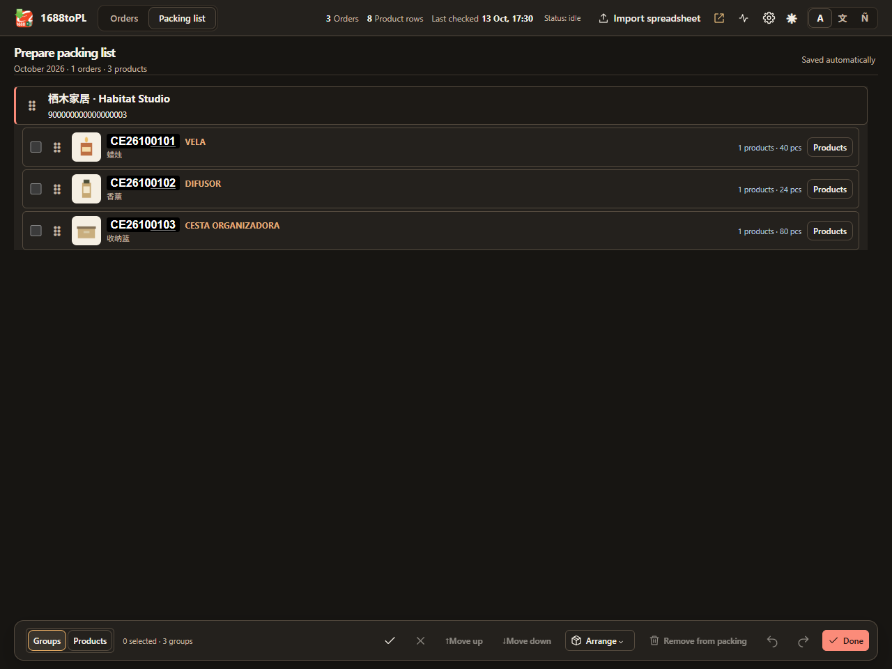

# Packing lists and codes

[Documentation](README.md) · [Cartons](cartons.md) · [Exports](exports.md)

## Assign products

Select products in **Orders**, set **Packing month**, check the product/order count above the bottom bar, then **Prepare packing list**. New assignments always show a review, including a single product. It includes photos, month, proposed codes and naming/size/material suggestions. Choose **Assign codes and prepare**, or **Assign only** to save eligible assignments and keep your Orders selection. Assign only needs identified sellers and cannot move already assigned products to another month. Cancel changes neither packing nor reservations.

With no selected rows, Prepare reopens products already assigned to the chosen packing month across saved orders. It does not select purchases by date. **Packing list** reopens that month without changing Orders selection. **Orders** returns only after valid packing edits save. Packing month begins at the current month when the workspace opens; explicit choices persist while it is open.

Moving month changes only selected products. A partly selected group splits; unselected products keep their month and codes. A move of existing codes requires review. **Seller unavailable** orders need a real seller member login before assigning labels; their good source rows and totals remain saved.

Use **Skip packing** for fees and other excluded rows. **Skipped** restores eligibility. This autosaved choice survives refresh, reload and backups without changing source money, selection or existing preparation edits. The launch button shows eligible/skipped counts and is unavailable when all selected products are skipped. Linked payment sources remain excluded until their payment links are removed.

## Edit and review

Each group starts with its base code, Spanish name and Chinese category. Variants show full codes, source price/quantity and their own descriptions. Known products receive local naming suggestions; unknowns stay unnamed. Materials are suggested conservatively and remain blank when uncertain. Manual text, including a deliberate blank, takes priority. Apply a shared material to a group/order only when appropriate.

**Variant code** holds model/color letters, such as A/B/C. **Size code** holds endings such as S/M/L/XS/XL or your configured mappings. Swapping these fields shows a specific error and preserves the last saved assignment. Existing legacy suffixes remain readable. Unresolved sizes, missing categories and invalid/conflicting codes have recovery actions; invalid label previews hide while unrelated valid labels remain visible.

Local size rules compare complete compatible measurements. Two sizes suggest S/L, three S/M/L, four S/M/L/XL and five XS/S/M/L/XL. Every compared axis must agree. Crossing dimensions, partial evidence and mixed assortments remain for review. **Review size suggestions** may offer a price-based S/L proposal for exactly two otherwise matching unclear textual sizes; price alone never assigns a size.

For styles incorrectly called sizes, choose **Sizes → No size difference**. It clears size endings while retaining variant letters; code changes are reviewed. Returning to Automatic rechecks unresolved values. Typing an explicit size ending also restores automatic mode while retaining your value. Equal complete measurements do not become different sizes solely because prices differ.

Changes autosave. Pending invalid edits remain visible and block leaving or output until corrected. **Undo / Redo** lasts throughout the open packing session, including after autosave, for names, codes, grouping, arrangement, removal, materials, size handling and reset/restore. Multi-order edits undo together. Reloading or reopening starts a new history. Another tab's newer edits require reload before continuing.

Double-click a product, or press Enter, for its original details. When a packing row represents multiple source products, choose which source to inspect. Copy source values with their nearby controls; click a photo outside its copy button to zoom. [Photo and keyboard controls](keyboard-shortcuts.md) preserve your selection.

## Organize and group

Click groups to add/remove them from export selection without clearing other groups. The bottom selection toolbar holds select-all/clear, Excel image, Copy and **Grouping**. Packing copying needs selected products in displayed orders; backup covers the whole open preparation.

**Organize** opens a separate management view:

- **Groups** shows compact code/photo/name/count cards. Move whole order blocks, or groups within their source order.
- **Products** focuses on one chosen group, reached through its visual searchable chooser. Move products within that group.
- Use drag handles, arrow-key handles or **Move up / Move down**. **Arrange** offers Store, Group code, or Store then group code. Hidden groups keep their places.

Management selection is independent of export selection. **Done / Escape** saves valid edits and restores normal packing selection and scroll. Arrangement preserves codes and source money and controls output order. Long lists scroll continuously; selection and output include offscreen products.

**Grouping** can share one barcode within each selected group, give combined rows separate barcodes, split selected variants into new products, or merge complete groups from one order/month. Each action explains its required scope and reviews photos/codes first. Different orders are never merged; source financial rows remain separate even when a barcode is shared. Repeat purchases have their own [reviewed linking workflow](operations.md#repeat-purchases).

**Organize → Remove from packing** reviews selected products and affected cartons before discarding their session edits, including autosaved changes. Previously prepared products recover session-start values; newly prepared products become unassigned. Shared changes and carton consequences save atomically and support Undo/Redo. Original purchases remain intact; empty packing orders leave the selector.

**Reset order and codes** restores default grouping, order, codes and endings while retaining matching names. **Restore previous packing** recovers the checkpoint before the latest month move. Both review changes and validate current ownership.

## Code ownership and conflicts

The base format is `CEYYMMGGII`: packing year/month, monthly seller group `01–99`, then product number `01–99`. Allocation continues across that seller's purchases and opens another group after product 99. Variant and size endings form the full barcode, such as `CE26103102ALS`. Display badges underline only the four product-number digits; copying retains the literal string.

Only current assignments block code reuse. Changing or removing one releases its old code even if a label was copied previously. A linked repeat code stays reserved while another purchase uses it. Checkpoints and Undo values do not reserve retired codes. Independent libraries do not coordinate numbering.

**Resolve code** shows both products with photos, store/date context and editable base/variant/size values. Review before/after changes, then **Apply corrections** to save all changed orders together, including swaps. A failed correction saves neither. **Continue editing** cancels popup changes; **Undo code edits** restores saved codes while retaining names/materials; **Use next available code** stages a suggestion. **Keep saved version** discards pending edits for that order. Successful corrections undo together.

Errors reveal and focus the affected field, even outside the visible scroll window. Small reviews show complete comparisons; large assignment/move reviews offer an overview with full comparisons on selection and arrow-key navigation. Long review actions remain reachable above scrolling content.
